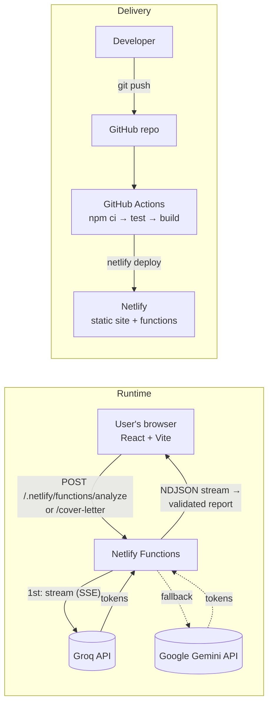

# ResumeMatch AI

**Paste your resume and a job description to get an AI-generated match report (scores, missing keywords, an ATS check, rewritten bullets) plus a tailored cover letter, streamed live as the AI writes.**

🔗 **Live demo:** https://resume-matchai.netlify.app


<!-- Add a screenshot or GIF at docs/screenshot.png -->

---

## ✨ Features

- **Match score (0–100)** with a one-line verdict
- **ATS compatibility score (0–100)** with a list of concrete ATS issues
- **Keyword analysis:** matched keywords, plus missing ones tagged *critical* or *nice to have*
- **Section-by-section feedback:** summary, experience, skills, education, projects
- **Bullet rewrites:** weak bullets rewritten into stronger ones, with a reason for each change and a one-click **Copy** button
- **Prioritized suggestions** and highlighted **red flags**
- **Live streaming:** the report fills in section by section as the model writes it
- **Cover letter generator:** a tailored first draft in a professional, enthusiastic or concise tone, with Copy and Download
- **Export:** download the report as Markdown, or save it as a PDF from the browser's print dialog
- **Copy all missing keywords** with one click (critical ones first)
- **Choose your AI:** *Auto* (Groq first, Gemini fallback) or pin one model. Each option explains its trade-offs, and the report shows which model answered
- **Split-view workspace:** after analysis, inputs dock on the left (edit and re-analyze) while the report scrolls on the right
- **Glassmorphism UI:** frosted surfaces over a soft gradient. Solid surfaces when the system asks for reduced transparency
- **PDF upload:** text is extracted in the browser with pdfjs-dist. Scanned or image-only PDFs are detected and reported.
- Live character counters, validation, rotating loading messages and a **Try with sample data** button
- Light and dark mode, responsive down to 360px, keyboard accessible, and respects `prefers-reduced-motion`

## 🧰 Tech stack


| Layer       | Choice                                                            |
| ----------- | ----------------------------------------------------------------- |
| Frontend    | React 18 + Vite, plain CSS with custom properties (no UI library) |
| PDF parsing | `pdfjs-dist` (client-side, lazy-loaded)                           |
| Backend     | Netlify Functions (Node 20, ES modules)                           |
| LLM         | Groq (OpenAI-compatible) → Google Gemini fallback, REST + SSE via `fetch` (no SDKs) |
| Testing     | Vitest + Testing Library (jsdom)                                  |
| Hosting     | Netlify                                                           |
| CI/CD       | GitHub Actions → Netlify CLI                                      |

## 🏗️ Architecture



## 📁 Project structure

```
.
├── .github/workflows/deploy.yml   # CI/CD: prod deploy on main, draft preview on PRs
├── netlify/
│   ├── functions/analyze.mjs      # Streaming analysis endpoint
│   ├── functions/cover-letter.mjs # Streaming cover-letter endpoint
│   ├── lib/                       # Providers (Groq/Gemini), fallback runner, prompts,
│   │                              # validation, normalization, rate limiting
│   └── tests/                     # Function + server lib tests
├── public/favicon.svg
├── src/
│   ├── components/                # InputPanel, ScoreRing, KeywordChips, SectionFeedback,
│   │                              # BulletRewrites, Suggestions, Results, ReportActions,
│   │                              # CoverLetter, CopyButton (+ tests)
│   ├── lib/api.js                 # Streaming client: NDJSON events, errors, timeouts
│   ├── lib/partialJson.js         # Parses the report while it is still streaming
│   ├── lib/report.js              # View shaping, Markdown export, clipboard/download
│   ├── lib/pdf.js                 # PDF text extraction
│   ├── lib/sample.js              # Sample resume + JD
│   ├── App.jsx
│   ├── main.jsx
│   └── index.css
├── .env.example
├── netlify.toml
└── vite.config.js
```

## 💻 Local setup

**Prerequisites:** Node.js 20 or later, plus at least one free API key: [Groq](https://console.groq.com/keys) (recommended, very fast) and/or [Gemini](https://aistudio.google.com/app/apikey).

```bash
# 1. Clone
git clone https://github.com/<your-username>/ResumeMatchAI.git
cd ResumeMatchAI

# 2. Install
npm install

# 3. Configure environment
cp .env.example .env
# then edit .env and set GROQ_API_KEY and/or GEMINI_API_KEY

# 4. Run the app and the function together
npm run netlify:dev
```

Open **http://localhost:8888**.

Run the tests with `npm test`, or `npm run test:watch` while developing.

> `npm run dev` starts only the Vite frontend (port 5173), so the `/.netlify/functions/analyze` endpoint won't exist. Use `npm run netlify:dev` for the full app. Netlify Dev reads `.env` automatically.

## 🚀 Deployment (GitHub Actions → Netlify)

1. **Get API keys.** Create a free key at [Groq](https://console.groq.com/keys) and/or [Google AI Studio](https://aistudio.google.com/app/apikey). One is enough; with both, Groq is used first and Gemini is the fallback.
2. **Push the project to GitHub.** Create a new repository and push this code to the `main` branch.
3. **Create a Netlify site.** Use one of these:
   - **CLI:** `npx netlify login`, then `npx netlify sites:create --name your-site-name`
   - **Dashboard:** *Add new site → Deploy manually* (drag in any folder, such as `dist`).
     ⚠️ Don't choose "Import from Git". GitHub Actions should be the only thing that deploys, otherwise every push builds twice.
4. **Copy the Site ID.** It's under Netlify → *Site configuration → Site details → Site ID*.
5. **Create a personal access token.** Go to Netlify → *User settings → Applications → Personal access tokens → New access token*.
6. **Add GitHub secrets.** In the repo, open *Settings → Secrets and variables → Actions → New repository secret* and add:
   - `NETLIFY_AUTH_TOKEN`: the token from step 5
   - `NETLIFY_SITE_ID`: the Site ID from step 4
7. **Add Netlify environment variables.** In Netlify → *Site configuration → Environment variables*, add:
   - `GROQ_API_KEY` and/or `GEMINI_API_KEY`: at least one is required. Mark them as secret.
   - `GROQ_MODEL`: optional, defaults to `llama-3.3-70b-versatile`
   - `GEMINI_MODEL`: optional, defaults to `gemini-flash-latest`
   - `LLM_PROVIDERS`: optional order, defaults to `groq,gemini`

   The API keys go in **Netlify, not GitHub**, because the functions run on Netlify.
8. **Deploy.** Push to `main`, watch the **Actions** tab, then open your `https://<site>.netlify.app` URL. Pull requests to `main` get a draft preview deploy, and its URL is posted on the PR.

### 🩺 Troubleshooting

| Symptom | Likely cause and fix |
| --- | --- |
| **401 / "Unauthorized"** in the Actions deploy step | `NETLIFY_AUTH_TOKEN` is wrong, expired or missing. Create a new token and update the GitHub secret. |
| **"Site not found"** in Actions | `NETLIFY_SITE_ID` is wrong. Copy it again from Site details. |
| **Function returns 500 "not configured"** | Neither `GROQ_API_KEY` nor `GEMINI_API_KEY` is set in Netlify's environment variables. Add it and redeploy, because env changes only apply to new deploys. |
| **404 on `/.netlify/functions/analyze`** | The functions path is wrong. It must be `netlify/functions` in both `netlify.toml` and the `--functions` flag. Locally, use `npm run netlify:dev`. |
| **"rejected the request" / "model was not found"** | The key is invalid, or the model name is retired. Fix the key or `*_MODEL` variable and redeploy. Function logs (Netlify → *Logs → Functions*) show the upstream status. |
| **"The AI took too long"** | The provider is slow or overloaded. Add a Groq key (much faster), or set `GEMINI_MODEL=gemini-flash-lite-latest`. |
| **Build fails with "Secrets scanning found secrets"** | A non-secret value (such as a model name) was marked secret in Netlify. Untick "Contains secret values" for it, or add it to `SECRETS_SCAN_OMIT_KEYS` in `netlify.toml`. |
| **CORS errors** | These shouldn't happen, because the frontend and the function share an origin. If you see one, you're probably calling the function from a different domain. |

## 🔐 Security notes

- **API keys stay in serverless functions.** The browser only calls `/.netlify/functions/analyze` and `/cover-letter`. Keys are read from `process.env` on the server, sent to the provider in request headers (never in the URL), and never included in the frontend bundle or the Git history (`.env` is git-ignored).
- **Input validation:** POST only (other methods get 405). Both fields are required, the resume must be 200–15,000 characters and the job description 100–10,000. Invalid input gets a clear 400.
- **Rate limiting:** 10 requests per IP per 10 minutes, with a friendly 429. This runs in memory, so it is best-effort only: counters reset on cold starts and aren't shared between instances.
- **Prompt-injection handling:** The resume and job description are wrapped in delimiters, delimiter sequences in user text are stripped, and the prompt tells the model to treat both strictly as data and ignore instructions inside them. The output is parsed as JSON, checked against the expected shape (with safe defaults for anything missing) and scores are clamped to 0–100, so a manipulated response can't break the UI.
- **Safe errors:** Clients only get clean JSON error messages, never stack traces or upstream details. Full errors are logged server-side with `console.error`.
- **Timeouts and fallback:** Each provider gets its own timeout inside a 25-second total budget, so the function always ends with a clean error instead of a platform timeout. If a provider fails part-way, the client is told to discard the partial output before the next provider starts.
- **Tests:** 50+ Vitest tests cover validation, rate limiting, prompt building, provider fallback, key-leak checks, streaming parsing and the main UI flows. CI runs them on every push and PR.
- **Privacy:** Nothing is stored. Data goes to Gemini for analysis only.

## 🛣️ Future improvements

- User accounts and authentication
- Saved analysis history
- DOCX resume upload
- More LLM providers (Cerebras, OpenRouter, Anthropic) through the same adapter interface
- End-to-end browser tests with Playwright
- Durable rate limiting backed by a database or Redis

## 📄 License

MIT © Harish Kumar
